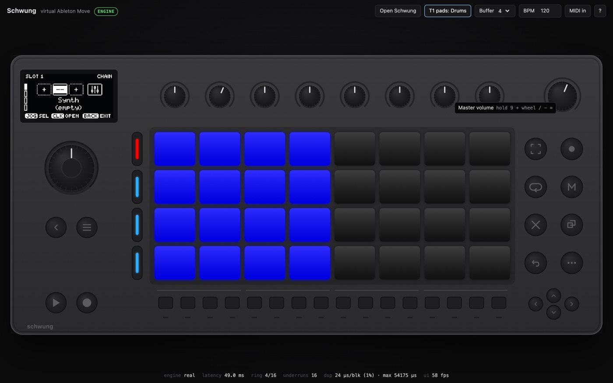

# schwung-wasm

[Schwung](https://schwung.dev), the open-source framework that adds synths, effects and tools to
the Ableton Move, running in a web browser with realtime audio.

This is not a re-creation. The page runs Schwung's own code, compiled to WebAssembly:

- **the shim** (`schwung_shim.c`): what loads on the Move beside Ableton's firmware, mixes the
  chain slots, routes MIDI and serves parameters;
- **the chain host**, loading modules with its real `dlopen()`;
- **the shadow UI**: QuickJS running Schwung's 85k lines of UI JavaScript, unmodified, drawing
  the 128×64 OLED;
- **catalog modules**, rebuilt from their own repositories (106 so far; 98 verified making sound inside the engine, the rest need audio input or a sample chosen).

Around it sits a virtual Move: the front panel (pads, knobs, buttons, jog, LEDs, OLED), and a
small "Virtual Move" that stands in for Ableton's firmware, which can't be emulated.



## Run it

Needs Docker (for the pinned Emscripten image), Node 20+ and git.

```bash
git clone --recursive https://github.com/Vochsel/schwung-wasm && cd schwung-wasm
bash scripts/build-modules.sh     # catalog modules, cloned at pinned commits (~2 min)
bash scripts/build-engine.sh      # the engine → web/engine/ (~1 min)
node scripts/serve.mjs            # → http://localhost:8790
```

Press **Power on**. Then:

- **Open Schwung**: Shift + touch Volume + a Track button (or the *Open Schwung* button / `Q`).
- Pick a slot's synth with the jog wheel (turn = scroll, click = choose), **Back** to leave.
- Play the pads. Track 1 is a drum rack (notes 36+); Tracks 2–4 are melodic (C major, rows a
  fourth apart). The *T1 pads* button toggles the layout per track.
- `?` shows every control and keyboard shortcut.

What you set up is saved in the browser (IndexedDB) and comes back on reload.

## How it works

On the Move, Ableton's firmware talks to the hardware once per 128-frame block through an SPI
mailbox, and Schwung's shim hooks that call. Here a "device" thread does both sides: it plays
the hardware (audio out to an AudioWorklet through a SharedArrayBuffer ring, MIDI in from the
panel, the OLED's slice protocol) and the firmware (pads become notes on the selected track's
channel, a transport clock, a home screen). The shim, chain and shadow UI run unchanged between
the two, as pthreads sharing one memory where the device has processes sharing `/dev/shm`.

[docs/ARCHITECTURE.md](docs/ARCHITECTURE.md) has the full map, [docs/SCOPE.md](docs/SCOPE.md)
the original feasibility study, [docs/MODULES.md](docs/MODULES.md) the module pipeline and
status, [docs/WEB.md](docs/WEB.md) the front-end and controls.

## What works, what doesn't

| | |
|---|---|
| Schwung shadow UI: slots, chain editor, module picker, parameters, Master FX, settings | runs as on the device |
| 4 chain slots: synth + MIDI FX + audio FX, mixing, sends | runs as on the device |
| Catalog modules | 106 build from source; 98 verified making sound in the engine ([status](docs/MODULES.md)) |
| Persistence | slot state, presets and settings in IndexedDB |
| Latency | ≈ 12 ms of engine buffering plus the browser's output latency |
| Move's own instruments, sequencer, clips and sets | **not possible**: they live in Ableton's closed firmware |
| Schwung features that read Move's song (automation lanes, p-locks, mute/solo follow, Link Audio) | inert without Move |
| Modules that need the network, `fork`, ROMs that can't be redistributed, or have no licence | not built |

Chromium-based browsers are tested; the page needs cross-origin isolation (COOP/COEP), which
`scripts/serve.mjs` sets.

## Development

```bash
node tests/drive.mjs "shift+vol+track1" "click" "jog 1" "click" "pad 3 0"   # headless; OLED PNG per step
node tests/catalog.mjs [ids]      # load each module into the real engine and check it sounds
node scripts/test-module.mjs      # each module alone in a minimal host
node scripts/smoke.mjs            # the web page end to end
```

Upstream Schwung is pinned as a submodule and never edited; `patches/apply.py` makes small,
guarded edits to a copy (every one behind `#ifdef SCHWUNG_WASM`). See [AGENTS.md](AGENTS.md).

## Licence

MIT for this repository. Schwung is MIT (© Charles Vestal). Modules keep their own licences and
are built from their own repositories; see [LICENSE](LICENSE) for what that means when a build
bundles GPL or AGPL modules.

Not affiliated with or endorsed by Ableton. "Ableton" and "Move" are trademarks of Ableton AG.
